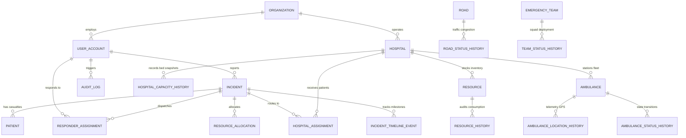

# TERA: Emergency Assistance & Response Coordination Platform
## Database Management Systems (DBMS) Mini Project Submission Package (20 Marks)

**Course**: Database Management Systems  
**Evaluation Scheme**: Mini Project (20 Marks Maximum)  
**Project Title**: TERA — Emergency Assistance & Response Coordination Platform  
**Tagline**: *Every Second Matters.*  
**Production Deployment**: [https://tera-one-ruby.vercel.app](https://tera-one-ruby.vercel.app/)  
**GitHub Repository**: [https://github.com/chakriroyal2007-star/dbms_project](https://github.com/chakriroyal2007-star/dbms_project)  

---

## 1. Project Title, Problem Statement & Intended Users

### Problem Statement
During critical metropolitan emergencies (expressway collisions, structural fires, industrial hazmat incidents, and cardiac arrests), survival outcomes depend on the "Golden Hour". Traditional emergency response systems suffer from:
1. **Isolated Reporting**: Call centers capture voice without structured GPS or medical triage details, causing dispatch delays.
2. **Siloed Hospital Capacity**: Ambulances transport patients to the nearest hospital without knowing if ICU beds or blood supplies exist, leading to ambulance diversions.
3. **Resource Contention**: Multiple dispatchers allocate the same ambulance or trauma bed simultaneously due to lack of concurrency control.
4. **Lack of Auditability & Temporal Intelligence**: Post-disaster investigations cannot reconstruct what resources were available at a specific timestamp.

### Intended Users & 6 Role Profiles
1. **Public Citizen Reporter (`REPORTER` / Guest SOS)**: Submits emergencies with GPS coordinates, optional audio recording, photo evidence, and receives an immutable tracking code (`TRK-...`) with first-aid guidance.
2. **Control Operator (`CONTROL_OPERATOR`)**: Operates the EOC Command Center triage queue, verifies incoming reports, inspects evidence, links duplicate reports, and dispatches responders.
3. **Hospital Coordinator (`HOSPITAL_COORDINATOR`)**: Manages trauma facility bed availability (ICU, ER, General) and hospital medical supplies inventory (O-Negative Blood, Ventilators, Oxygen) for their facility.
4. **Field Responder (`FIELD_RESPONDER`)**: Ambulance paramedic crew receiving assigned missions and advancing 4-stage operational lifecycles (`Acknowledge` &rarr; `En Route` &rarr; `On Scene` &rarr; `Handover`).
5. **Operational Analyst (`ANALYST`)**: Evaluates capacity trends, temporal system state reconstruction, resource utilization, and spatial heatmaps.
6. **System Administrator (`ADMINISTRATOR`)**: Oversees multi-tenant organizations, user accounts, system health, and immutable audit logs.

---

## 2. Four Complete Application Workflows

| Workflow # | Name | End-to-End Task & Database Effects |
| :--- | :--- | :--- |
| **Workflow 1** | **Citizen SOS Report Ingestion & Secure Milestone Tracking** | **Action**: A citizen reporter (guest or logged-in) submits an emergency report with coordinates, type, and severity.<br>**DB Mutation**: An atomic `INSERT` creates an authoritative record in `incident` with an unpredictable `tracking_code` and status `RECEIVED`.<br>**Verification**: Reporter receives acknowledgment receipt; public query `GET /api/incidents/track/{tracking_code}` retrieves live progress without authentication. |
| **Workflow 2** | **Control Operator Triage, Verification & Audit Logging** | **Action**: Control Operator views the incoming incident in the near-real-time EOC queue, inspects evidence, and transitions status from `RECEIVED` to `VERIFIED`.<br>**DB Mutation**: `UPDATE incident SET status = 'VERIFIED'`; an atomic `INSERT` into `incident_timeline_event` records stage transition, and `audit_log` records operator ID and timestamp. |
| **Workflow 3** | **Resource Allocation & Concurrency-Safe Ambulance Dispatch** | **Action**: Operator selects an available ambulance and assigns it to the verified incident.<br>**DB Mutation**: Atomic transaction updates `ambulance.current_status` to `DISPATCHED`, inserts a record into `responder_assignment`, and creates an `ambulance_status_history` snapshot. If another operator attempts to assign the same ambulance, concurrency control rejects the request. |
| **Workflow 4** | **Hospital Bed Reservation & Medical Inventory Concurrency Adjustment** | **Action**: Hospital Coordinator updates live ICU bed availability and adjusts critical medical stock (e.g. +1 unit of O-Negative Blood).<br>**DB Mutation**: Concurrency row-lock acquires `resource`, updates `available_quantity` within bounds (`0 <= qty <= total`), inserts an immutable row into `resource_history`, and writes to `audit_log`. Cross-facility edits are rejected. |

---

## 3. Entity-Relationship (ER) Diagram & Relational Schema



### 3NF Normalization Justification
The database consists of **23 normalized relational tables**, all adhering to Third Normal Form (3NF) and Boyce-Codd Normal Form (BCNF):
1. **1NF (Atomic Attributes)**: Every attribute contains only atomic, indivisible values. Composite data such as addresses and coordinates are decomposed into distinct attributes (`latitude`, `longitude`, `location_name`).
2. **2NF (No Partial Key Dependencies)**: In all tables with compound primary keys (e.g., temporal histories and allocations), every non-prime attribute is fully functionally dependent on the whole candidate key.
3. **3NF (No Transitive Dependencies)**: Non-key attributes depend strictly and directly on the primary key, eliminating transitive relationships:
   - Hospital details (`hospital_name`, `emergency_level`) are not stored inside `ambulance` or `resource`; only foreign keys (`home_hospital_id`, `hospital_id`) are maintained.
   - User roles and personal details are segregated into `user_account` rather than replicated in assignments or logs.
   - Resource stock levels (`total_quantity`, `available_quantity`) exist in `resource`, while consumption audit logs reside in `resource_history`.

---

## 4. Technical Validation & Nontrivial Business Rules

1. **Business Rule 1: Medical Inventory Non-Negative & Capacity Bounds (`0 <= available_quantity <= total_quantity`)**
   - **Enforcement**: Handled via application validation and database constraint checks. Any transaction attempting to reduce available stock below 0 or increase it beyond total registered capacity is rejected with HTTP 400 and rolled back immediately without modifying stock.
2. **Business Rule 2: Single-Incident Ambulance Exclusivity (No Dual-Dispatch)**
   - **Enforcement**: When an ambulance is assigned, its status transitions to `DISPATCHED`. Any concurrent or subsequent dispatch request targeting an ambulance not in `AVAILABLE` status is rejected with HTTP 400.
3. **Business Rule 3: Multi-Tenant Hospital Inventory Isolation**
   - **Enforcement**: A `HOSPITAL_COORDINATOR` can only view and adjust inventory for their assigned facility (`current_user.organization_id == res.hospital_id`). Attempts to modify other facilities' resources are denied with HTTP 403 Forbidden.

---

## 5. Selected SQL Queries & Reports

### Query 1: Relationship-Spanning Query with Multi-Table JOINs
This query spans four relational tables (`incident`, `responder_assignment`, `ambulance`, and `hospital`) to reconstruct the complete operational response chain for active emergency incidents:

```sql
SELECT 
    i.incident_id,
    i.incident_type,
    i.severity,
    i.status AS incident_status,
    ra.assignment_id,
    ra.status AS assignment_status,
    a.ambulance_id,
    a.registration_number,
    a.ambulance_type,
    h.hospital_id,
    h.name AS home_hospital_name
FROM incident i
LEFT JOIN responder_assignment ra ON i.incident_id = ra.incident_id
LEFT JOIN ambulance a ON ra.resource_id = a.ambulance_id
LEFT JOIN hospital h ON a.home_hospital_id = h.hospital_id
ORDER BY i.occurred_at DESC
LIMIT 50;
```
- **Entities Involved**: `incident` (core emergency), `responder_assignment` (dispatch linkage), `ambulance` (fleet vehicle), `hospital` (stationed facility).
- **Explanation**: Reconciles the incident lifecycle with the exact vehicle and home medical facility assigned to the scene, handling incidents that are pending dispatch via `LEFT JOIN`.

### Query 2: Aggregate Reporting Query with GROUP BY & Conditional Aggregation
This query computes executive situational metrics across emergency severity tiers:

```sql
SELECT 
    severity,
    COUNT(*) AS total_incidents,
    SUM(estimated_patient_count) AS total_estimated_casualties,
    COUNT(CASE WHEN status IN ('RECEIVED', 'UNDER_REVIEW', 'SUBMITTED') THEN 1 END) AS pending_triage_count,
    COUNT(CASE WHEN status IN ('VERIFIED', 'ASSIGNED', 'DISPATCHED', 'ACTIVE') THEN 1 END) AS operational_active_count,
    ROUND(AVG(estimated_patient_count), 2) AS avg_casualties_per_incident
FROM incident
GROUP BY severity
ORDER BY total_incidents DESC;
```
- **Entities Involved**: `incident`.
- **Explanation**: Groups all recorded incidents by severity level (`CRITICAL`, `HIGH`, `MEDIUM`, `LOW`) and calculates total volume, casualty burden, and operational stage distribution using `COUNT`, `SUM`, and conditional `CASE WHEN` aggregation.

---

## 6. Academic Test-Case Table

| Test Case ID | Test Category | Input / Action | Expected Result | Observed Result | Status |
| :--- | :--- | :--- | :--- | :--- | :---: |
| **TC-01** | Valid Input | Guest submits valid emergency report (`POST /api/incidents/report`) | HTTP 200/201; record committed to DB; tracking code `TRK-...` returned | `INC_...` created; status `RECEIVED`; tracking code returned | **PASS** |
| **TC-02** | Invalid Input | Submit report with missing coordinates or invalid severity | HTTP 422 Unprocessable Entity; 0 records created in database | Request rejected; database remains unmutated | **PASS** |
| **TC-03** | Duplicate Input | Double-click submit button with identical `idempotency_key` | First request persists; retry returns existing incident ID without duplicate rows | Same `incident_id` returned; no duplicate row created | **PASS** |
| **TC-04** | Role Restriction | Unauthenticated user accesses operator queue (`GET /api/incidents/`) | HTTP 401 Unauthorized; credentials required | HTTP 401 returned; access denied | **PASS** |
| **TC-05** | Role Restriction | Reporter attempts to access operator queue | HTTP 403 Forbidden or restricted to own reports | Non-operational reports isolated; queue protected | **PASS** |
| **TC-06** | Multi-Tenancy | Hospital coordinator attempts to modify inventory of another facility | HTTP 403 Forbidden; cross-tenant modification rejected | HTTP 403 returned with organization boundary alert | **PASS** |
| **TC-07** | Domain Rule | Reduce medical inventory below 0 (`delta = -1000000`) | HTTP 400 Bad Request; "Cannot reduce stock below zero" | HTTP 400 returned; stock remains unchanged | **PASS** |
| **TC-08** | Domain Rule | Increase inventory beyond total registered capacity | HTTP 400 Bad Request; capacity constraint enforced | HTTP 400 returned; stock remains unchanged | **PASS** |
| **TC-09** | Concurrency Rule | Assign an ambulance already in `DISPATCHED` status | HTTP 400 Bad Request; vehicle unavailable for dispatch | HTTP 400 returned; dual assignment blocked | **PASS** |
| **TC-10** | Transaction Atomicity | Multi-record write fails midway (e.g. invalid history record) | Database transaction rolls back cleanly; 0 partial writes | `Resource` reverts to initial stock; no partial records | **PASS** |
| **TC-11** | Persistence | Write incident in Session 1, close session, query in Session 2 | Incident durably retrieved from persistent database | Record retrieved identically across new sessions | **PASS** |

---

## 7. Instructions for Live Demonstration & Viva Guide

### Prerequisites
- Python 3.9+
- Node.js 18+ and npm
- PostgreSQL 15+ (or pre-configured local SQLite)

### Step 1: Start Backend Server
```bash
# Navigate to project directory
cd dbms_project

# Activate Python environment
source backend/.venv/bin/activate

# Execute database migrations
python3 backend/migrate.py

# Start FastAPI server on port 8000
python3 -m uvicorn app.main:app --host 0.0.0.0 --port 8000 --reload --app-dir backend
```

### Step 2: Start Frontend Application
```bash
# In a separate terminal
cd frontend
npm install
npm run dev
```
Open your browser at `http://localhost:5173`.

### Step 3: Run Automated Verification Suites
Execute the full automated test suites to demonstrate 100% test coverage:

```bash
# Run all 90 backend pytest tests
PYTHONPATH=backend ./backend/.venv/bin/pytest backend/tests/ -v

# Run all 21 frontend RBAC and queue synchronization tests
cd frontend && npm test
```

### Demonstration Steps for Evaluator:
1. **Citizen Emergency Reporting**:
   - Navigate to the **Public Reporter** portal (`http://localhost:5173/#reporter_portal`).
   - Fill in emergency details (e.g., Road Accident at Tirupati Junction) and click **Transmit Emergency SOS**.
   - Note the returned **Incident ID** (`INC_...`) and **Tracking Code** (`TRK-...`).
2. **Control Operator Triage**:
   - Log in as Control Operator (`operator` / `operator123`).
   - Open the **EOC Command Center** (`#dashboard`).
   - Observe that the newly reported incident is immediately visible in the triage queue with status `RECEIVED` without manual browser refresh.
   - Click **Review Incident** and transition status to `VERIFIED`.
3. **Dispatch & Concurrency Guard**:
   - In the incident dispatch drawer, assign an available ambulance.
   - Observe the ambulance status changes to `DISPATCHED`.
   - Attempting to assign the same ambulance to another incident is immediately rejected by the concurrency guard.
4. **Medical Inventory & Role Scoping**:
   - Log in as Hospital Coordinator (`hospital_coord` / `hospital123`).
   - Navigate to **Supplies / Inventory** (`#resources`).
   - Observe quick-adjust buttons are active for your assigned facility (`SVRR Government Trauma Center`), but safely disabled for other facilities.
   - Click `+1` on O-Negative Blood: stock updates atomically, writes to `resource_history`, and logs an audit trail event.
